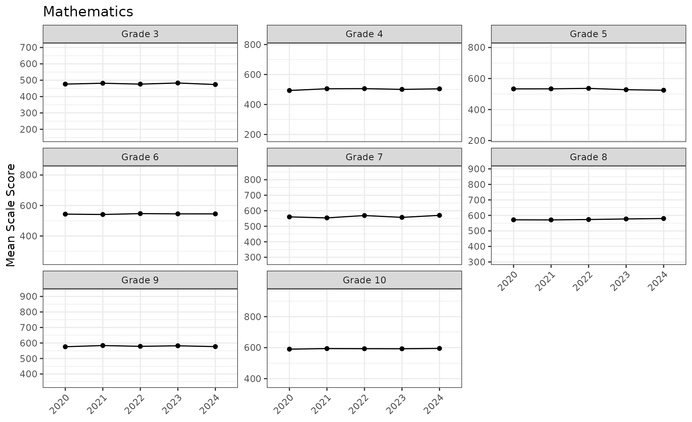
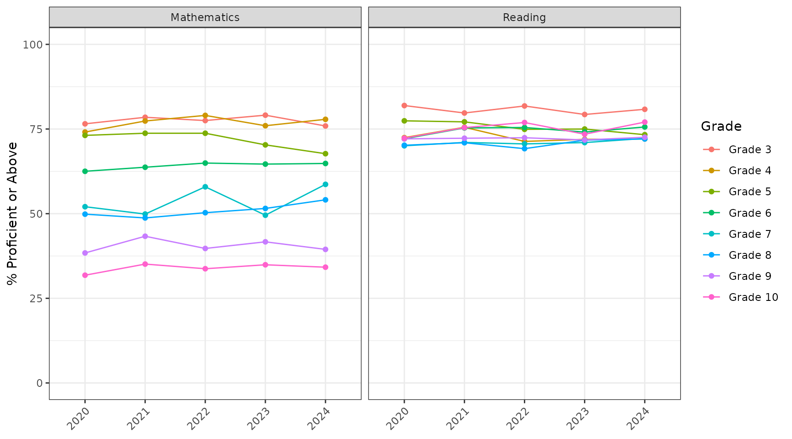
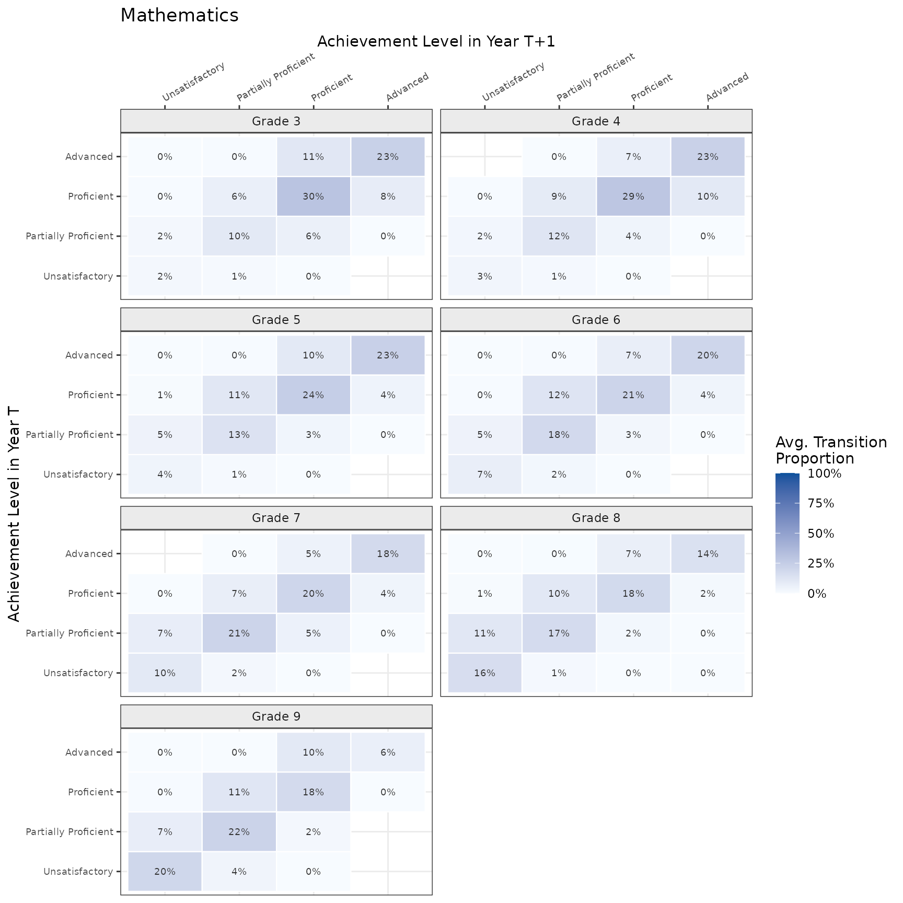
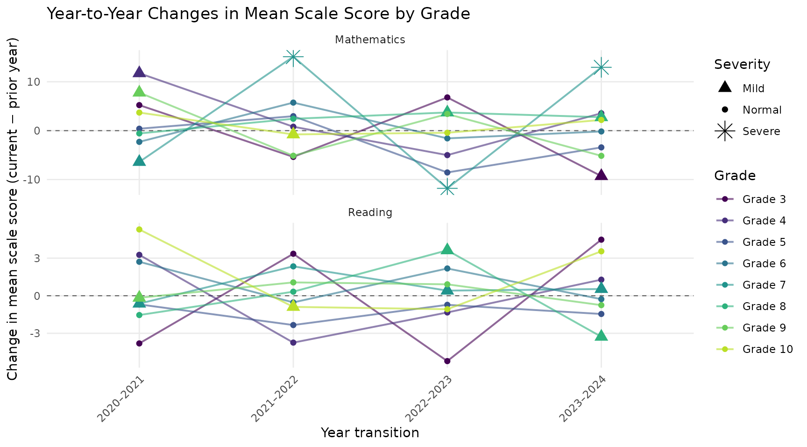
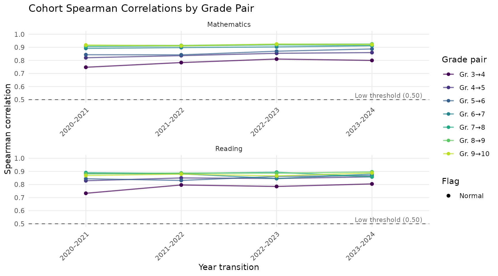
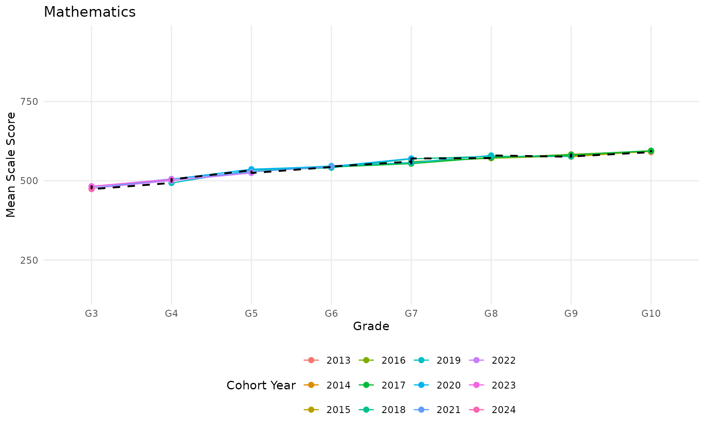

# Walkthrough: from student records to a report

This walkthrough runs ReportR from start to finish on `sgpData_LONG`, a
simulated statewide data set from the SGPdata package. It holds five
years (2020–2024) of reading and mathematics results for grades 3–10,
about 366,000 student test records. Every table, plot, and narrative on
this page was produced by the code shown, and the whole walkthrough runs
in about a minute.

You will:

1.  [Prepare the student records](#prepare-the-student-records)
2.  [Describe the assessment](#describe-the-assessment)
3.  [Run the general trend analysis](#run-the-general-trend-analysis)
    and look inside the results
4.  [Check score quality](#check-score-quality)
5.  [Run the other lines of analysis](#run-the-other-lines-of-analysis)
6.  [Save the results and export
    tables](#save-the-results-and-export-tables)
7.  [Render a report](#render-a-report)

The last section, [Adapting ReportR to your
state](#adapting-reportr-to-your-state), lists what changes when you use
your own data.

## Before you start

Install ReportR from GitHub and the SGPdata package from CRAN:

``` r

install.packages(c("devtools", "SGPdata", "openxlsx"))
devtools::install_github("ndadey/ReportR")
```

Then load the packages:

``` r

library(ReportR)
library(SGPdata)
library(dplyr)
```

## Prepare the student records

Every ReportR analysis reads one data frame, `student_results_long`,
with one row per student, year, and subject. Start from the raw records,
keep the valid cases, and standardize the column names:

``` r

student_results_long <- sgpData_LONG |>
  filter(VALID_CASE == "VALID_CASE") |>
  standardize_student_results()
```

[`standardize_student_results()`](https://ndadey.github.io/ReportR/reference/standardize_student_results.md)
renames common source columns to the names ReportR expects. Columns keep
their positions, so comparing names side by side shows what changed:

``` r

renamed <- names(sgpData_LONG) != names(student_results_long)

data.frame(
  original     = names(sgpData_LONG)[renamed],
  standardized = names(student_results_long)[renamed]
) |>
  knitr::kable()
```

| original                  | standardized   |
|:--------------------------|:---------------|
| CONTENT_AREA              | SUBJECT        |
| ID                        | STUDENT_ID     |
| ETHNICITY                 | RACE_ETHNICITY |
| FREE_REDUCED_LUNCH_STATUS | FRL            |
| ELL_STATUS                | EL             |
| IEP_STATUS                | IEP            |
| SCHOOL_NUMBER             | SCHOOL_ID      |
| DISTRICT_NUMBER           | DISTRICT_ID    |

It also converts academic-year labels to the year the test was given:

``` r

unique(sgpData_LONG$YEAR)
#> [1] "2021_2022" "2022_2023" "2023_2024" "2019_2020" "2020_2021"
sort(unique(student_results_long$YEAR))
#> [1] 2020 2021 2022 2023 2024
```

**Standardize before filtering by year.** Raw SGP-format data stores
years as text such as `"2019_2020"`, so a filter like
`YEAR %in% 2022:2024` returns no rows until the years have been
converted.

### State-specific cleanup

Every state’s data needs a little cleanup that no general function can
anticipate. This data needs two fixes:

- Some records have no scale score (achievement level `"No Score"`).
  They can’t contribute to score analyses, so drop them.
- Yes/no flags carry a label prefix, for example `"ELL: Yes"` and
  `"IEP: No"`. School-level percentages count `Yes`, `Y`, `TRUE`, or `1`
  as “yes”, so strip the prefix. Gender gets the same treatment so its
  values read `Female` and `Male`.

``` r

student_results_long <- student_results_long |>
  filter(!is.na(SCALE_SCORE)) |>
  mutate(across(c(FRL, EL, IEP, GENDER), ~ sub("^.*: ", "", .x)))
```

Here are all of one student’s records. The same `STUDENT_ID` appears in
every year the student was tested, which is what makes cohort analyses
possible:

``` r

one_student <- student_results_long$STUDENT_ID[1]

student_results_long |>
  filter(STUDENT_ID == one_student) |>
  arrange(SUBJECT, YEAR) |>
  select(STUDENT_ID, YEAR, SUBJECT, GRADE, SCALE_SCORE,
         ACHIEVEMENT_LEVEL, FRL) |>
  knitr::kable()
```

| STUDENT_ID | YEAR | SUBJECT     | GRADE | SCALE_SCORE | ACHIEVEMENT_LEVEL    | FRL |
|:-----------|-----:|:------------|------:|------------:|:---------------------|:----|
| 1000372    | 2022 | MATHEMATICS |     3 |         435 | Proficient           | Yes |
| 1000372    | 2023 | MATHEMATICS |     4 |         461 | Proficient           | Yes |
| 1000372    | 2024 | MATHEMATICS |     5 |         444 | Partially Proficient | Yes |
| 1000372    | 2022 | READING     |     3 |         523 | Partially Proficient | Yes |
| 1000372    | 2023 | READING     |     4 |         540 | Partially Proficient | Yes |
| 1000372    | 2024 | READING     |     5 |         473 | Unsatisfactory       | Yes |

## Describe the assessment

Everything specific to an assessment program lives in one R file, the
**assessment spec**. ReportR ships with a spec for this demo data.
Sourcing it creates a list called `assessment_spec`:

``` r

source(system.file("specs/00_DEMO_Assessment_Spec.R", package = "ReportR"))
names(assessment_spec)
#> [1] "program"            "subjects"           "achievement_levels"
#> [4] "scale_scores"       "years"              "demographics"      
#> [7] "notes"
```

The spec names the achievement levels, from lowest to highest, and which
level counts as proficient:

``` r

assessment_spec$achievement_levels
#> $labels
#> [1] "Unsatisfactory"       "Partially Proficient" "Proficient"          
#> [4] "Advanced"            
#> 
#> $policy_benchmark
#> [1] "Proficient"
```

For each subject and grade it records the lowest and highest obtainable
scale scores (LOSS and HOSS) and the cut scores between levels:

``` r

get_score_spec(assessment_spec, "MATHEMATICS", grade = 5)
#> $loss
#> [1] 220
#> 
#> $hoss
#> [1] 800
#> 
#> $cuts
#> [1] 421 493 561
```

Each cut is the highest score in the lower level, and a score’s level is
the number of cuts it exceeds, plus one. A grade 5 mathematics score of
500 exceeds the first two cuts (421 and 493), so it is level 3:
Proficient.

The analysis code never hardcodes any of these values, so the same
functions work for a four-level or five-level assessment, and for
end-of-course subjects as well as grade-level ones. To describe your own
assessment, copy the template and fill it in:

``` r

file.copy(
  system.file("specs/00_TEMPLATE_Spec.R", package = "ReportR"),
  "00_MyState_Assessment_Spec.R"
)
```

## Run the general trend analysis

Each line of analysis has one function that runs all of its
sub-analyses. Line 1, general trend, asks how performance has changed
over time:

``` r

general_trend_results <- run_general_trend_analysis(
  student_results_long = student_results_long,
  assessment_spec      = assessment_spec,
  min_n                = 10
)

names(general_trend_results)
#> [1] "score_trends"            "proficiency"            
#> [3] "distributions"           "achievement_transitions"
#> [5] "params"
```

Cells with fewer than `min_n` students have their statistics set to
missing. To limit the analysis to recent years, add
`report_years = 2022:2024`.

### Inside the results

Each sub-analysis keeps its outputs together. Scale score trends, for
example, have a table, plots, and text:

``` r

names(general_trend_results$score_trends)
#> [1] "table" "plot"  "text"
```

**The table** has one row per subject and grade, with year-by-year
means, standard deviations, and counts. Here are the mathematics means:

``` r

general_trend_results$score_trends$table |>
  filter(SUBJECT == "MATHEMATICS") |>
  select(GRADE, ends_with("_Mean")) |>
  knitr::kable(digits = 1)
```

| GRADE | 2020_Mean | 2021_Mean | 2022_Mean | 2023_Mean | 2024_Mean |
|------:|----------:|----------:|----------:|----------:|----------:|
|     3 |     476.3 |     481.6 |     476.2 |     483.0 |     473.7 |
|     4 |     493.2 |     504.9 |     505.8 |     500.7 |     504.3 |
|     5 |     533.2 |     533.5 |     536.5 |     528.0 |     524.5 |
|     6 |     543.4 |     541.1 |     546.8 |     545.2 |     545.1 |
|     7 |     560.5 |     554.1 |     569.2 |     557.4 |     570.4 |
|     8 |     571.6 |     571.1 |     573.5 |     577.2 |     580.0 |
|     9 |     575.8 |     583.6 |     578.5 |     581.9 |     576.8 |
|    10 |     590.3 |     594.0 |     593.2 |     592.8 |     595.0 |

**The plots** are ggplot objects, one per subject for each plot type
(`mean_trend`, `mean_sd`, `median_iqr`, and `grade_profile`). Each
grade’s panel spans that grade’s score range:

``` r

general_trend_results$score_trends$plot$mean_trend$MATHEMATICS
```



**The narrative** is written from the results, so report text always
matches the numbers:

``` r

cat(general_trend_results$score_trends$text$narrative)
```

Changes in mean scale scores from 2020 to 2024:

**Mathematics**

- Grade 3: ↓ 2.6 points (2020 → 2024)
- Grade 4: ↑ 11.1 points (2020 → 2024)
- Grade 5: ↓ 8.6 points (2020 → 2024)
- Grade 6: ↑ 1.7 points (2020 → 2024)
- Grade 7: ↑ 9.9 points (2020 → 2024)
- Grade 8: ↑ 8.3 points (2020 → 2024)
- Grade 9: → 0.9 points (relatively flat) (2020 → 2024)
- Grade 10: ↑ 4.7 points (2020 → 2024)

**Reading**

- Grade 3: ↓ 1.2 points (2020 → 2024)
- Grade 4: → 0.5 points (relatively flat) (2020 → 2024)
- Grade 5: ↓ 5.2 points (2020 → 2024)
- Grade 6: ↑ 4.1 points (2020 → 2024)
- Grade 7: ↑ 2.7 points (2020 → 2024)
- Grade 8: → 0.9 points (relatively flat) (2020 → 2024)
- Grade 9: ↑ 1.1 points (2020 → 2024)
- Grade 10: ↑ 6.9 points (2020 → 2024)

### Proficiency and achievement-level transitions

The proficiency sub-analysis tracks the percent of students at or above
the policy benchmark:

``` r

general_trend_results$proficiency$plot$trend
```



Achievement-level transitions follow the same students from one grade
and year to the next grade the following year, and show how often they
moved up, stayed at the same level, or moved down. In each grade’s
heatmap, a cell is the share of all matched students who were at one
level (row) and reached another level (column) a year later, averaged
across year pairs. The diagonal holds the students who stayed at the
same level:

``` r

general_trend_results$achievement_transitions$matrices$plot$heatmap$MATHEMATICS
```



## Check score quality

Line 4 looks for patterns worth investigating before results are shared:
pileups at the floor or ceiling of the scale, scores outside the valid
range, unusual year-to-year changes, shifts in how strongly scores
correlate across years, and unusual distribution shapes.

``` r

anomaly_results <- run_anomaly_analysis(student_results_long, assessment_spec)

names(anomaly_results)
#> [1] "loss_hoss"       "score_integrity" "outliers"        "correlations"   
#> [5] "distributions"   "params"
```

The score integrity check compares every score with the spec. It flags
scores outside the LOSS–HOSS range, and achievement levels that disagree
with the cut scores:

``` r

cat(anomaly_results$score_integrity$text$narrative)
```

All scale scores fall within the valid LOSS–HOSS range defined in the
assessment specification, and all recorded achievement levels are
consistent with the cutpoints for their respective subject and grade. No
data integrity issues were identified.

That makes it a quick test of a new spec, too. Out-of-range scores or
level mismatches usually mean a score range or cut score in the spec is
wrong.

The outlier check flags subject, grade, and year cells whose change from
the previous year is unusually large compared with the other cells:

``` r

cat(anomaly_results$outliers$text$narrative, sep = "\n\n")
```

17 year-subject-grade combinations showed unusual year-to-year changes
(3 Severe, 14 Mild; threshold: ±2 SD from the mean change).

Among all cells, the largest change in mean scale score was a 15.1-point
increase in MATHEMATICS Grade 7 (2022); the largest change in percent
proficient was a 9.1 pp increase in MATHEMATICS Grade 7 (2024).

At least one demographic composition shift was also flagged as an
outlier.

``` r

anomaly_results$outliers$plot$score
```



The correlation check follows the same students from one grade to the
next. Stable correlations across years suggest the scores rank students
consistently:

``` r

anomaly_results$correlations$plot$line
```



## Run the other lines of analysis

The remaining lines work the same way: one function call, one results
list.

### Enrollment (Line 1.2)

Who was tested, and how has the tested population changed?

``` r

enrollment_results <- run_general_enrollment_analysis(
  student_results_long, assessment_spec
)

enrollment_results$counts$by_year |>
  select(YEAR, N, N_change, N_pct_change) |>
  knitr::kable(digits = 1)
```

| YEAR |     N | N_change | N_pct_change |
|-----:|------:|---------:|-------------:|
| 2020 | 35410 |       NA |           NA |
| 2021 | 36400 |      990 |          2.8 |
| 2022 | 36915 |      515 |          1.4 |
| 2023 | 37437 |      522 |          1.4 |
| 2024 | 38066 |      629 |          1.7 |

Enrollment in SGPdata Public Demo Assessment increased from 35,410
students in 2020 to 38,066 in 2024, a net change of 2,656 (7.5%). Grade
3 showed the largest cumulative shift, having gained 549 students over
the period. Among subgroups, the proportion of Yes (FRL) increased by
4.0 percentage points between 2020 and 2024. Across subjects and grades,
the relationship between enrollment change and mean score change was
weak and negative (r = -0.11), suggesting that enrollment changes did
not consistently predict score direction.

### Cohort (Line 1.3)

Cohort analysis follows the same students as they move through the
grades, which requires student IDs that persist across years. Each
colored line is one cohort, labeled by the year its students were (or
would have been) in grade 3. The dashed line shows all students tested
in each grade, for comparison:

``` r

cohort_results <- run_cohort_analysis(student_results_long, assessment_spec)

cohort_results$plot$mean_scores$MATHEMATICS
```



[`run_general_cohort()`](https://ndadey.github.io/ReportR/reference/run_general_cohort.md)
runs the same analysis and also saves the results and renders the cohort
report in one step.

### School and district (Line 5)

The school and district line summarizes performance by school and
district. It also models each school’s proficiency rate from its
demographic composition (the percent of students who are FRL, EL, IEP,
and from minority groups), and flags schools well above or below what
the model predicts:

``` r

aggregate_results <- run_aggregate_analysis(student_results_long, assessment_spec)

aggregate_results$outliers$positive_outlier_schools |>
  select(SUBJECT, YEAR, SCHOOL_NAME, n_tested, pct_proficient,
         predicted_proficiency, residual) |>
  head() |>
  knitr::kable(digits = 1)
```

| SUBJECT | YEAR | SCHOOL_NAME | n_tested | pct_proficient | predicted_proficiency | residual |
|:---|---:|:---|---:|---:|---:|---:|
| MATHEMATICS | 2024 | Dodge Lake Elementary School | 47 | 89.4 | 48.0 | 41.4 |
| READING | 2020 | Yi Jiang Elementary-Middle Preparatory Academy | 353 | 92.1 | 63.0 | 29.1 |
| READING | 2024 | Salmon Run Elementary School | 127 | 86.6 | 62.6 | 24.0 |
| READING | 2021 | Yi Jiang Elementary-Middle Preparatory Academy | 366 | 88.8 | 65.4 | 23.4 |
| READING | 2024 | Dodge Lake Elementary School | 46 | 93.5 | 71.6 | 21.9 |
| READING | 2021 | Vitale Elementary School | 105 | 72.4 | 51.8 | 20.6 |

## Save the results and export tables

Save each results list once. Reports read the saved file, so you can
revise and render a report as often as you like without rerunning the
analysis.

``` r

output_dir <- file.path(tempdir(), "reportr-demo")  # or any folder you choose
dir.create(output_dir, showWarnings = FALSE)

saveRDS(general_trend_results,
        file.path(output_dir, "general_trend_results.rds"))
```

[`export_tables_to_excel()`](https://ndadey.github.io/ReportR/reference/export_tables_to_excel.md)
writes every table in a results list to its own worksheet, named after
its place in the list:

``` r

xlsx_file <- file.path(output_dir, "general_trend_tables.xlsx")
export_tables_to_excel(general_trend_results, xlsx_file)

sheets <- openxlsx::getSheetNames(xlsx_file)
length(sheets)
#> [1] 12
head(sheets, 4)
#> [1] "score_trends.table"      "score_trends.text.table"
#> [3] "proficiency.table"       "proficiency.text.table"
```

## Render a report

Each line of analysis has a Quarto report template. Copy the template
next to your saved results, then render it with Quarto. The report reads
the results file and the spec, and writes a Word document:

``` r

file.copy(
  system.file("templates/01_General_Trend_Report.qmd", package = "ReportR"),
  output_dir
)

quarto::quarto_render(
  input          = file.path(output_dir, "01_General_Trend_Report.qmd"),
  output_format  = "docx",
  execute_params = list(
    spec_file    = system.file("specs/00_DEMO_Assessment_Spec.R",
                               package = "ReportR"),
    results_file = file.path(output_dir, "general_trend_results.rds"),
    report_years = 2022:2024
  )
)
```

Rendering requires [Quarto](https://quarto.org) and the `quarto` R
package. `report_years` limits the main tables to recent years. Leave it
out to show every year. The templates are ordinary Quarto documents, so
edit your copy to add state-specific context or change the layout.

| Line | Results from | Template |
|----|----|----|
| 1\. General trend | [`run_general_trend_analysis()`](https://ndadey.github.io/ReportR/reference/run_general_trend_analysis.md) | `01_General_Trend_Report.qmd` |
| 1.2 Enrollment | [`run_general_enrollment_analysis()`](https://ndadey.github.io/ReportR/reference/run_general_enrollment_analysis.md) | `01_Enrollment_Trends_Report.qmd`, `01_Enrollment_Brief.qmd` |
| 1.3 Cohort | [`run_general_cohort()`](https://ndadey.github.io/ReportR/reference/run_general_cohort.md) | `01_General_Cohort_Report.qmd` |
| 4\. Score quality | [`run_anomaly_analysis()`](https://ndadey.github.io/ReportR/reference/run_anomaly_analysis.md) | `04_Anomaly_Report.qmd` |
| 5\. School and district | [`run_aggregate_analysis()`](https://ndadey.github.io/ReportR/reference/run_aggregate_analysis.md) | `05_Aggregate_Analysis_Report.qmd` |

## Adapting ReportR to your state

1.  **Write a spec.** Copy `00_TEMPLATE_Spec.R` and fill in your
    subjects (their codes must match the `SUBJECT` values in your data),
    grades (`NULL` for end-of-course subjects), achievement levels,
    policy benchmark, score ranges, and cut scores. The Mississippi and
    Arkansas specs in `system.file("specs", package = "ReportR")` are
    complete examples.
2.  **Prepare your data.** Load your records, run
    [`standardize_student_results()`](https://ndadey.github.io/ReportR/reference/standardize_student_results.md),
    then do your state’s cleanup: recode subject codes and
    achievement-level labels to match the spec, set yes/no flags to
    `Yes`/`No`, and drop records that shouldn’t be analyzed.
3.  **Check the spec against the data.** Run
    [`run_anomaly_analysis()`](https://ndadey.github.io/ReportR/reference/run_anomaly_analysis.md)
    and read `$score_integrity`. Out-of-range scores or level mismatches
    point to a score range or cut score that needs fixing.
4.  **Run, save, and render.** Run the lines you need, save each results
    list, and render the matching report templates.
